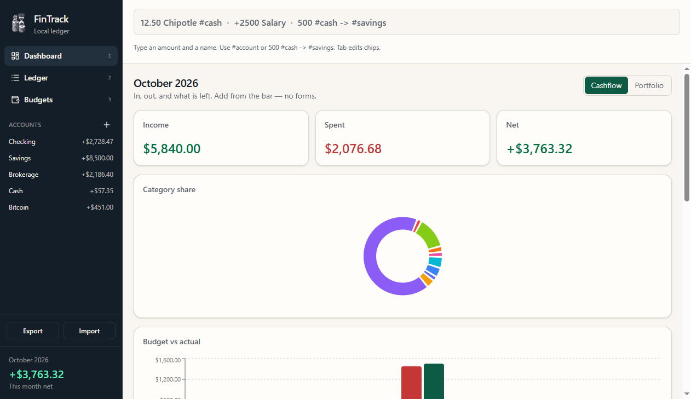
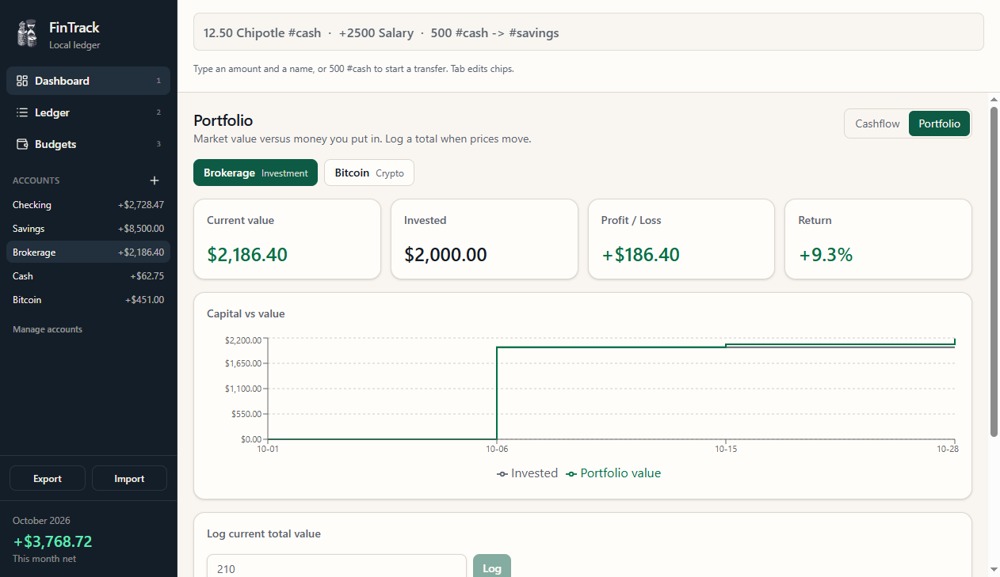
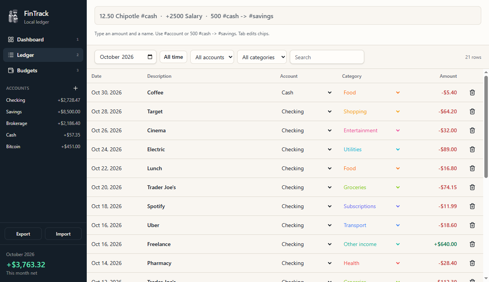
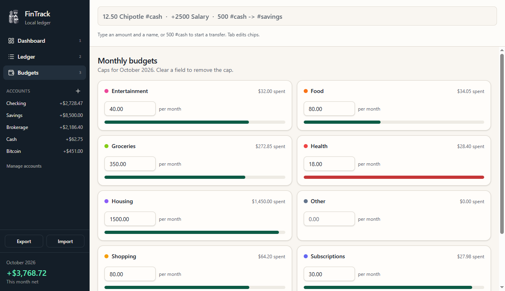

# FinTrack

<p align="center">
  
</p>

Local-first personal finance for the desktop. Type a transaction, press Enter, and the ledger, budgets, and portfolio stay in sync — with no account and no server.

FinTrack is a keyboard-first alternative to a spreadsheet. The packaged app is a [Tauri](https://v2.tauri.app/) window around a static web UI. Every record lives in IndexedDB on the machine that runs it.

<p align="center">
  
</p>

## Features

- **Quick Add.** A formula bar is focused on launch. Amount, description, category, account, and date are one line. There is no dialog to dismiss.
- **Ledger.** Dense, editable transaction list with search and filters. Deletes are undoable.
- **Accounts.** Bank, cash, savings, and portfolio accounts (investment, crypto, stock). Transfers move money between accounts and are excluded from income and spending.
- **Cashflow.** Month totals, per-account balances, and charts.
- **Portfolio.** Market value, invested principal, profit, and a time-weighted return so a new deposit is not treated as a gain.
- **Budgets.** A monthly cap per category.
- **Workbook.** Export and import `fintrack-YYYY-MM-DD.xlsx` (accounts, categories, transactions, budgets, valuations). One undo reverts an import.

## Screenshots

**Portfolio** — market value versus money you put in, with a time-weighted return.

<p align="center">
  
</p>

**Ledger** — a dense, editable transaction list with search and filters.

<p align="center">
  
</p>

**Budgets** — a monthly cap per category, with spend against the cap.

<p align="center">
  
</p>

## Getting started

You need [Node.js](https://nodejs.org/) and npm. The desktop window also needs the [Rust toolchain and Tauri prerequisites](https://v2.tauri.app/start/prerequisites/) for your OS (on Windows, that includes the Microsoft C++ build tools and WebView2).

```bash
npm install
npm run dev           # UI only, http://localhost:1420
npm run tauri dev     # desktop window
npm run build         # production frontend → dist/
npm run tauri build   # installer; binary is FinTrack.exe on Windows
```

On Windows, each `npm run tauri build` gives the MSI a newer version and the same upgrade identity. Running that MSI replaces the FinTrack already installed and leaves the ledger in place. Uninstall only when you want to discard the app, not between test builds.

On first launch the app seeds a Cash account, a USD / en-US setting, and a small set of income and expense categories.

## Logging a transaction

| You type | Result |
| --- | --- |
| `12.50 Chipotle` | Expense on the default account, today |
| `+2500 Salary` | Income |
| `12.50 Chipotle @food #cash yesterday` | Category, account, and date |
| `500 #cash -> #savings` | Transfer |
| `transfer 500 from #checking to #savings` | Transfer, written out |

`@` is a category. `#` is an account. Omit `#` and the entry uses the default account. Amounts accept `12.50` and `12,50`. Date hints include `today`, `yesterday`, `tomorrow`, and weekday names.

The bar previews the parsed entry before you commit it. Categories you do not type are filled from merchant memory, then a fuzzy match, then Uncategorized.

| Key | Action |
| --- | --- |
| Enter | Commit Quick Add, or a budget amount |
| `/` or Ctrl+K | Focus Quick Add |
| Tab | Cycle the category, account, and date chips |
| Esc | Clear the bar |
| Ctrl+Z | Undo the last change (20 deep), including an import |
| 1 / 2 / 3 | Dashboard, Ledger, Budgets |

## How it's built

Money is stored as integer cents. Account balances and portfolio figures are derived from the ledger and valuation log; they are not saved as their own records. A portfolio's current value is the latest valuation plus transfers booked after that date. Return is time-weighted across those cash flows.

The UI talks to storage through one context. Views are app state (`dashboard`, `transactions`, `budgets`), not routes.

```
src/
  components/    dashboard, ledger, budgets, sidebar, UI primitives
  context/       FinanceContext — the only persistence gateway
  lib/           parser, money, portfolio math, Dexie schema, Excel workbook
src-tauri/       Tauri 2 shell (no data commands; IndexedDB stays in the WebView)
```

| Layer | Choice |
| --- | --- |
| UI | React 19, TypeScript, Vite, Tailwind CSS |
| Desktop | Tauri 2 |
| Data | Dexie (IndexedDB) |
| Charts | Recharts |
| Workbook | SheetJS |

## License

FinTrack is released under the [MIT License](LICENSE).
